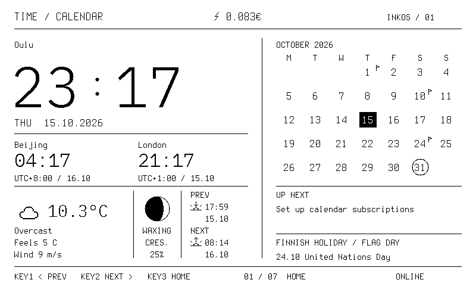
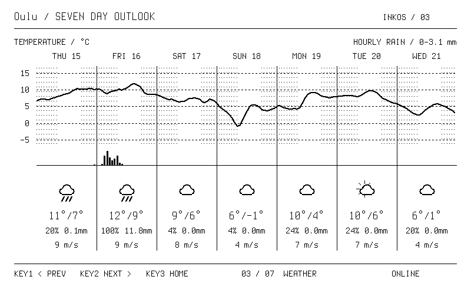
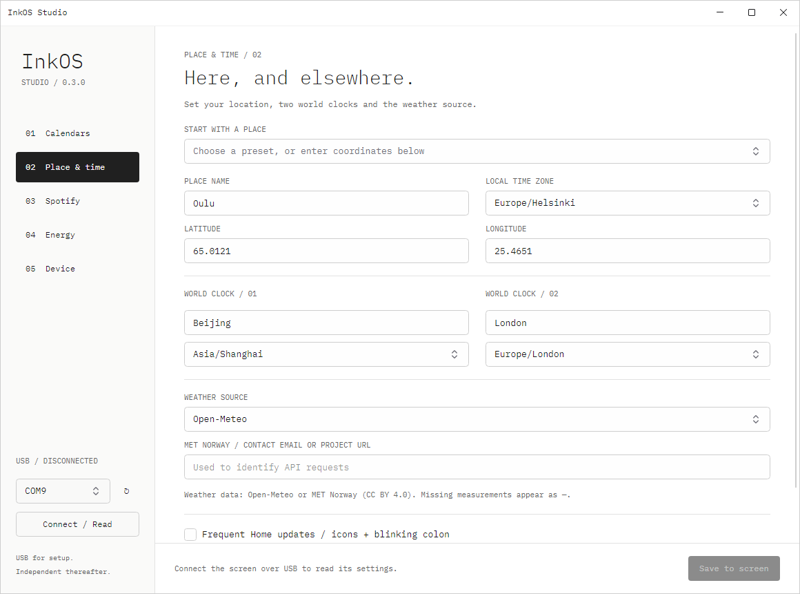

# InkOS

ESP32 独立运行的 7.5 英寸黑白墨水屏桌面看板，配套 C# ShadUI 设置应用。

[English](README.en.md) · [完整文档](docs/README.md) · [下载 Releases](https://github.com/DynamixYANG/InkOS/releases) · [MIT License](LICENSE)



**固件 0.3.1 / Studio 0.3.0**。设备基于 ESP32 Arduino 内置 FreeRTOS，自行联网、计算、绘图和刷新。电脑只用于烧录、修改设置及 Spotify 的一次性授权，日常运行无需常驻服务器。

## 功能

| 页面 | 内容 |
|---|---|
| Home | 本地时间、两个世界时钟、芬兰节假日月历、下一事项、天气、月相、前后日出／日落事件、当前电价 |
| Music | Spotify 播放状态、黑白专辑封面、同步歌词上下文 |
| Weather | 七天气温曲线、降水柱、昼夜分层、气象图标、高低温、降雨概率和风速 |
| Week | 周一至周日日程；时间、标题、地点固定分列；全天／跨天事项和溢出数量 |
| Moon | 月相、照明比例、月龄、阶段时间线、下次主要月相日期 |
| Sun | 日出、日落、太阳高度曲线、晨光、正午和暮光 |
| Energy | 芬兰 FI 区电价；当前小时居中，过去和未来各 12 小时；可配置 VAT、margin、transmission |

KEY1 上一页，KEY2 下一页，KEY3 主页，七页循环切换。默认地区是 Oulu，世界时钟默认北京和伦敦。界面使用英文。



## 硬件与显示

已验证硬件为 **Seeed TRMNL 7.5 OG DIY / XIAO ESP32-S3 Plus**，16 MiB Flash、8 MiB OPI PSRAM，800×480 单色 UC8179 面板。连接与 GPIO 见 [硬件说明](docs/HARDWARE.md)。其他同尺寸面板需要分别验证控制器、引脚和波形。

字体采用 Terminus 原生点阵与 IBM Plex Mono Light，按原生尺寸输出 1-bit 像素。小字体保持一像素笔画，不做运行时缩放或灰度抗锯齿。

当前版本优先保证对比度：使用面板工厂 OTP 波形，分钟级时钟局刷；高频图标动画和冒号闪烁默认关闭。此前短波形快刷出现静态文字变淡和背景变脏，已移除。详见 [显示与字体](docs/DISPLAY.md)。

## 快速开始

1. 从 [Releases](https://github.com/DynamixYANG/InkOS/releases) 下载固件包和 Windows Studio 包，或按 [构建文档](docs/BUILD.md) 自行编译。
2. 按 [硬件与烧录说明](docs/HARDWARE.md) 确认板型、串口和芯片 MAC。烧录工具先备份，再只写三个明确区域，保留 NVS。
3. 首次 Wi-Fi 配网使用临时 Python 配网页面；已有 Wi-Fi 设置会保留。步骤见 [配置指南](docs/CONFIGURATION.md)。
4. 打开 **InkOS Studio**，选择串口，点击 **Connect / Read**。设置地区、世界时钟、日历、Spotify 和电价，再 **Save to screen**。
5. 完成配置后关闭上位机；屏幕自行工作。



## 日历、Spotify 和电价

日历支持 Apple/iCloud、Google Calendar、Microsoft Outlook 的只读 ICS/webcal 订阅。Google Calendar 的私密 iCal 地址属于凭据，直接填入上位机，不要提交到仓库。这里只订阅日历，不读取 Gmail 邮件。详细步骤见 [配置指南](docs/CONFIGURATION.md)。

Spotify 使用你自己的开发者应用和官方 PKCE 授权，不需要 Client Secret。播放可以发生在手机或其他音箱，ESP32 查询状态并匹配 LRCLIB 歌词。当前尚未完成真实账号授权验证，歌词和语言覆盖也有限制。见 [Spotify 接入](docs/SPOTIFY.md)。

电价默认使用 FI 区 Sähkötin 数据，默认成本参数：

```text
VAT            = 25.5%
Margin         = 0.45 ct/kWh
Transmission   = 6.00 ct/kWh
Fees include VAT = false
Total ct/kWh   = (net spot + margin + transmission) × 1.255
```

勾选费用已含 VAT 后，公式改为 `net spot × 1.255 + margin + transmission`。主页使用 €/kWh，电价页使用 ct/kWh。小时价格是四个完整 15 分钟区间的平均，缺失数据留空。数据条款和计算边界见 [电价模块](docs/ENERGY.md)。

## 目录

```text
InkOS/
├── firmware/InkOS/       Arduino sketch、FreeRTOS 应用、分区表
│   └── src/             数据模型、数据源、绘图、页面、屏幕驱动
├── desktop/             ShadUI / Avalonia / C# 上位机与依赖许可证
├── assets/              原始字体、生成清单、SunCalc 许可证
├── libraries/           固定版本的 uICAL 递归规则引擎
├── tools/               可移植的构建、烧录、配置、截图、检查与打包工具
├── tests/               不需要硬件的工具层测试
├── docs/                架构、硬件、配置、接口、开发和验证文档
│   ├── images/          屏幕真实 framebuffer 与上位机示例图
│   └── validation/      去除设备身份和凭据后的验证摘要
├── .github/workflows/   持续集成
└── out/                 本地生成，Git 忽略，不上传原始设备数据
```

## 开发

Python 3.11+、Arduino CLI + ESP32 core **3.3.12**、.NET **10 SDK**。

```powershell
python -m venv .venv
.venv\Scripts\Activate.ps1
python -m pip install -r tools/requirements.txt
python -m unittest discover -s tests -v
python tools/check_repo.py
python tools/build.py
dotnet restore desktop/InkOS.Studio/InkOS.Studio.csproj --locked-mode
dotnet build desktop/InkOS.Studio/InkOS.Studio.csproj -c Release --no-restore
```

运行构建前需要安装 ESP32 core；完整安装命令和输出目录见 [BUILD](docs/BUILD.md)。修改页面、增加 provider、更新字体或迁移存储的约定见 [开发指南](docs/DEVELOPMENT.md)。

## 验证与边界

部署固件 0.3.1 已通过设备启动自检 **61/61**；检查过七页实际 framebuffer、72 小时电价公式和设置保留。原字体与保守刷新方案已获得实物清晰度反馈。新布局的像素检查不等同于长期实物残影测试。

当前周日程的实机画面为空状态；私有日历和 Spotify 账号仍需要各自配置。支持 28 个显式时区、最多三个日历源、96 条展开事项、35 天日程窗口。字库主要覆盖英文、芬兰语和拉丁字符，尚无 CJK 歌词。没有 OTA 分区。完整记录见 [VALIDATION](docs/VALIDATION.md)。

原创代码采用 [MIT](LICENSE)；第三方字体、SunCalc、uICAL 和桌面依赖保留各自许可证。MIT 不替代天气、音乐、歌词和电价服务的数据使用条款。见 [第三方说明](docs/THIRD_PARTY.md)。
