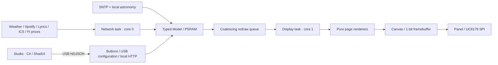

# 系统架构

## 设计目标与边界

InkOS 是 FreeRTOS 上的 ESP32 应用，不是 Linux。主控承担时间换算、日历展开、太阳与月亮计算、天气／电价／Spotify 拉取，以及完整 1-bit 渲染。外部服务提供原始数据，不提供页面截图。Studio 负责配置与一次性账号授权。

显示驱动、业务数据、页面布局和桌面设置各自独立；新增页面不应侵入网络协议，修改天气源不应要求修改绘图代码。

## 任务、内存和所有权

| 任务 | 核心 / 优先级 / 栈 | 责任 |
|---|---|---|
| display | core 1 / 2 / 12288 bytes | 获取快照，绘制页面，唯一调用 Panel 的任务 |
| network | core 0 / 1 / 16384 bytes | 串行执行外部 HTTP、同步和重试，发布数据 |
| control | core 1 / 1 / 12288 bytes | USB 命令、设备本地 HTTP、电池 ADC；非阻塞排空日志到 USB |
| input | core 1 / 3 / 3072 bytes | 编码器 ISR 通知与按键去抖，发布导航请求（0.7.1） |
| log-store | core 0 / 1 / 12288 bytes | 日志落盘、tar.gz 轮转、保留期与容量裁剪（0.7.7，见 [LOGS](LOGS.md)） |
| ota-health | core 0 / 1 / 4096 bytes | 任务心跳、启动健康确认与回滚 |

0.7.8 的任务、同步原语、切页时序和刷新时间预算图见 [交接说明](HANDOVER.md#2-架构摘要)。

Model、绘图快照和大缓冲区位于 PSRAM；内部 RAM 仍承担任务栈和部分 TLS 开销。大型 Model/Music 不放在任务栈上。现有 Model 约 99.4 KB，单张 framebuffer 为 48,000 bytes。

`modelMutex` 保护短时快照与发布；网络请求不能在持有它时进行。`frameMutex` 保护屏幕帧和调试抓取。Credentials 有单独的配置锁，不把密码、token 或 API key 拷贝进渲染 Model。

重绘队列容量为 1：快速到来的更新合并为“按最新状态重绘”，不会积累过时帧。Panel 仍有实际忙状态；动画目标频率不等于可保证的物理刷新频率。

0.6.1 的 PageNavigation 只由 display 任务持有，区分已提交整页、当前选择和已显示标题。control 任务递增 navigationRevision 并记录单调请求时间，局刷期间仍能采集按键；display 完成标题后重新读取最新请求，待标题可见且停按时间达到配置值，才绘制／提交整页。预览等待期间暂停正文更新，渲染后再次核对请求序号，丢弃过时目标。物理刷新开始后不可中断；期间新请求留到下一轮处理。

## 模块地图

| 模块 | 责任 |
|---|---|
| Domain | 页面枚举、Settings、Weather、Agenda、Music、Energy 与基础时间／节假日模型 |
| Configuration / Zones | USB 配置验证、NVS、支持的时区规则、世界时钟 |
| Http / Certificates | 验证 HTTPS、响应限额、状态码、Retry-After、有限重定向与解压 |
| Weather | Open-Meteo、MET Norway 转换成统一天气模型 |
| ICalendar / Calendars | ICS 字段解析、uICAL 重复展开、例外与覆盖、多源合并、缓存 |
| Spotify / Lyrics / Artwork | token 刷新、播放状态、LRC 时间戳、JPEG 到黑白封面 |
| Astronomy | 无网络的太阳／月亮近似计算和相邻事件查找 |
| Energy | 来源 adapter、单位和 15 分钟区间归一化、成本模型、价格缓存与重试 |
| Canvas / Fonts | 像素、线、图形和原生字模；没有设备联网操作 |
| Pages / WeekPage / AstronomyPages / EnergyPage | 用快照绘制页面，不写设置、不取网络数据 |
| Layout | 共用页边距、标题线、底栏、主页栏目边界 |
| Panel | 独占 SPI，工厂波形，全刷／局刷，old/new frame 和清理预算 |
| PageNavigation | 无硬件依赖的标题预览与停按计时状态；合并最新选页请求 |
| Hardware / StatusIcons | 编码器 IRQ／完整周期解码、ADC 采样和电量估计；统一电池与 Wi-Fi 图示 |
| CalDav | Apple 地址验证、有界 XML 与 calendar-query REPORT；复用 ICS 解析，不绘图 |
| WeatherIcons | WMO／日夜码到 MDI 原生位图映射；绘制与可选动画，不联网 |
| Runtime | 任务装配、调度、按键、USB 和本地调试端点 |
| desktop/InkOS.Studio | 独立 View、ViewModel、DTO、USB client、临时 Spotify PKCE callback |

Studio 的 ICloudCalendarClient 负责一次性 PROPFIND 发现与列表；ICloudView/主 ViewModel 只处理用户选择与通过 DeviceClient 写入。设备 NVS 的 icloud1 保存账户与单个集合，正常读取只返回 has_password。运行时仍由 network 任务串行执行 REPORT，不增加常驻电脑服务。编码器 ISR 仅积累有界步数，control 任务消费后调用统一导航，不在中断中绘图或请求网络。

## 一次数据更新如何到达屏幕

1. Network 读取当前配置副本，按到期时间发起 HTTPS。
2. Adapter 做单位与字段转换，缺失值保持 NAN／unknown，不能补造数据。
3. 短时间持锁发布 typed model，增加对应 revision，发送合并重绘通知。
4. Display 获取 Model 快照，并在锁外完成绘图。
5. Panel 比较 old/new 单色位图，仅传输变化的字节对齐区域；页面／设置／封面变化可强制全刷。
6. 每次完成后断开面板驱动电源，保留画面及所需 RAM；达到预算时进行维护全刷。

## 数据调度与失效

天气和日历通常每 15 分钟更新。天气失败会较快重试，并保留上次有效数据。Spotify 在 Music 页约 5 秒，其余页约 30 秒；单调播放时间线在采样间插值。电价有单独的公布时段、长间隔和失败退避，不每帧拉取。

用户切换来源时更新配置 revision。进行中的旧源请求完成后必须核对配置版本，不能把旧结果重新覆盖新设置。缓存也绑定来源 key。

时区显示不改变进程全局 TZ；系统保持 UTC，按显式 ZoneRule 做换算。电价以 UTC 小时为索引；日历以本地日界转换区间。这样跨午夜、夏令时跳时和重复小时的语义分开处理。

## 持久化合同

| 内容 | 位置／键 |
|---|---|
| Wi-Fi | NVS namespace wifi，ssid / pass |
| 常规设置 | inkos/settings2，原始 Settings 结构字节 |
| 日历配置 | inkos/feed0..feed2 |
| 电价配置 | inkos/energy1，独立 JSON |
| Spotify | inkos 的 client_id / refresh |
| 日历与电价缓存 | storage 分区上的 LittleFS |

Settings 原始字节保存方式对结构体布局敏感。增加字段前必须设计 schema/version 与迁移，不能直接改变 sizeof(Settings) 后假设旧配置可读。电价配置独立存放，正是为了避免破坏既有 settings2。

## 桌面程序边界

MainWindow 只承载侧栏与页面选择；Views 是六个独立设置区。MainViewModel 持有编辑模型、校验和命令状态；DeviceClient 串行发送请求并匹配响应，委托 UsbTransport 或 NetworkTransport。固件 executeCommand 共用命令分发；RemoteConfiguration 独立处理 USB 配对和 AES-GCM 网络信封。SpotifyAuthorization 独占临时浏览器授权状态。

Studio 不代设备抓天气、渲染屏幕或定时抓日历。关闭上位机不影响已配置设备的数据更新。对外 HTTP 是 ESP32 自己托管的调试与加密配置服务，不是上位机 server。

网络配置和凭据边界见 [NETWORK](NETWORK.md)。Wi-Fi 新配置独立保存在 `wifi/network1`，不改变 Settings 二进制结构和分区表。

0.4.3 的 `LyricMatching` 负责纯文本和版本匹配，`LyricHan` 提供 OpenCC 字符映射；`LyricsResolver` 注入 transport 并串行查询 LRCLIB／网易云；`LyricsService` 适配 ESP32 HTTPS、退避状态与 USB 固定曲目测试。Spotify 先发布播放快照，再执行可超时的歌词查询。歌词服务不写账号、日历或显示配置。

## OTA 与共享资源

`Ota` 封装 ESP-IDF 原生 A/B 写入、健康确认与回退；`Runtime` 提供任务心跳。`CjkAssets` 负责不可变字库的校验、内部分区映射与分块解压缓存，Canvas 仅依赖字形查询接口。`Storage` 独占 U5 设备注册、身份检查和外部 LittleFS 挂载，日历和电价只依赖存储接口。0.6 内部应用槽各 5.9375 MiB，字体在内部 `0xC00000`，文件系统全部在外部 4 MiB。Studio 和 Python CLI 复用已配对加密通道。普通 OTA 不修改共享字库、NVS 或 LittleFS；边界与分区见 [OTA](OTA.md)。

### Input isolation (0.7.1)

A GPIO ISR captures both GPIO41/42 levels in one `GPIO_IN1_REG` snapshot and accumulates validated full-cycle detents. The small `input` task drains them independently of the blocking `control` HTTP/USB task. Encoder state, pending movement and the lock deadline share one ISR-safe critical section. Target publication and the final full-refresh acceptance both hold `modelMutex`; an encoder-only gate is rechecked there to close the capture/delivery race. Locking clears pending movement and partial cycle state. KEY3 and software navigation bypass the encoder-only gate.

`PageNavigation` coalesces fast title requests and tracks only the newest target. The physical title preview still completes before the configurable quiet period begins. At final full-refresh acceptance the encoder gate is armed for the configured interval. Display buffers and panel I/O remain exclusively owned by the display task.

### Navigation-first rendering (0.7.2)

A validated encoder detent notifies the input task directly from the ISR; the task otherwise sleeps up to 10 ms to sample buttons. The display event queue wakes immediately for navigation. A small `DisplayState` and `RenderToken` are checked before any full Model snapshot. Titles bypass background work, and only the latest target is retained while hardware is busy. Body rendering is performed once during the quiet/title-visible interval, cached by token and invalidated by new data or input. No modelMutex is held across panel I/O.

`BackgroundSchedule` batches publishers for 40 ms (150 ms cap). Title/full-page acceptance still rechecks the navigation revision before starting panel work. The encoder gate and original factory waveform remain unchanged. Diagnostics separate dispatch latency, physical title completion, final acceptance, and full snapshot count.
