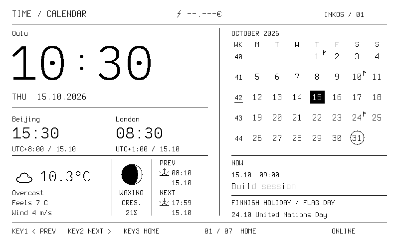
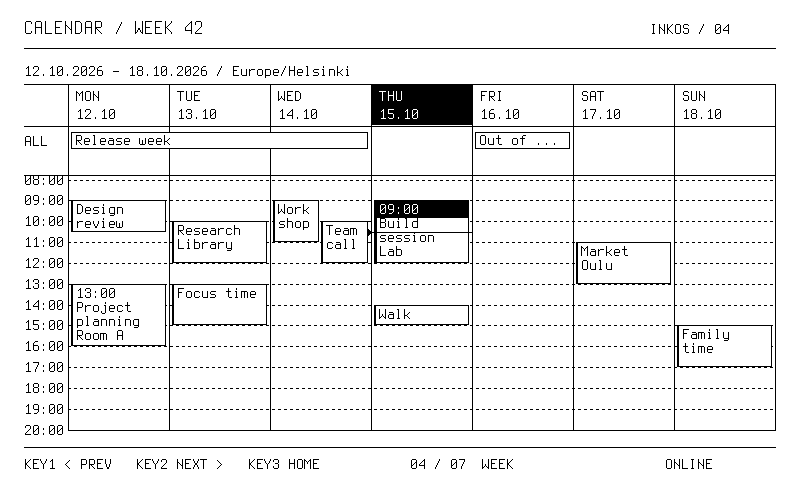

# 月历周序号与周时间网格

固件 **0.4.1 起**，0.4.2 加入中文。主页月历和 Week 使用同一个 ISO 周序号计算器，按地区设置中的本地日期计算；星期一为一周开始，包含 1 月 4 日的周为第 1 周。跨年时周所属年份可能与公历年份不同，例如 2021-01-01 属于 2020-W53。

## Home

月历左侧增加 `WK` 栏，每一行显示该周的两位序号，当前周加短下划线；保留今天反白、芬兰节日圆圈和旗日标记。周序号按实际日期计算，不按月内第几行编号。四、五、六行月份共用布局。WK 栏用留白与日期分组，不再添加贯穿月历的竖分隔线；WK 与周序号使用相同的居中轴。

左侧地区标签上移 8 px，主时钟及冒号整体上移 20 px，日期上移 12 px。腾出的空间分给时钟下方的日期、分隔线和世界时钟间距。字体、白底、气象和天文信息内容保持不变。



以上是正式固件绘图器生成的合成场景，不含私人日程。月历标题与左侧地区标签对齐。

## Agenda / 从今天起七天（0.7）

日程页不再固定显示周一至周日。第一列为地区时区中的今天，之后依次为未来六天；星期标签随日期生成，跨周、跨月、跨年不改变窗口长度。当前时间线与今天反白均固定在第一列。主页月历仍保留 ISO 周序号。

从本地“日期值”递增天数，再分别换算每一天的真实 UTC 边界，因此芬兰夏令时的 23／25 小时日不会令列错位。日历获取窗口也从今天开始向后 35 天，保留最多 96 条最近事项供主页和日程页共用。

顶部没有底部按键栏，右上角统一使用电池百分比和 Wi-Fi 强度图标。私有 iCloud 通过 App 发现列表、选择单个日历，随后由设备直接 CalDAV REPORT 拉取；详见 [iCloud 配置](ICLOUD.md)。

## 网格规则

- 顶部显示完整起止日期、本地时区；下方七列从今天开始，今天的表头反白。
- 全天事项独立放在顶部两行，跨日事项画为横跨多个日期列的单个条块；结束日期按排他边界处理。
- 定时事项放入下方小时网格。默认展示 08:00–20:00，自动扩展到包含所有本周事项及当前时间，最大 00:00–24:00，不隐藏夜间事项。
- 事件块保留纯白底与黑边，按可用高度显示开始时间、换行标题及地点。正在进行的事项强化左边线，足够高时将时间条反白。
- 当前时间用今天列中的细线和三角指示，每分钟随现有显示循环更新。它是当前时间指示，不是鼠标，也不改变现有三个按键的切页职责。
- 相互重叠的条块最多显示两列，全天事项最多显示两行；超出的条块数量统一放在相应日期表头 `+N` 中，不覆盖正文。

最小条块高度 20 px，保证短事件仍能显示一行字。非常短且相邻的事项可能因此并排显示；垂直位置只提供大致时间关系，过小的条块不能完整列出全部时间、标题和地点。当前没有触摸编辑、事件选中、滚动或切换到任意历史周的功能。私有订阅数据仍由设备每约 15 分钟获取。



以上事件均为合成样例。另见[密集事项](images/calendar/week-crowded.png)、[夏令时结束](images/calendar/week-dst.png)、[ISO 跨年](images/calendar/home-iso-year.png)和[六行月历](images/calendar/home-six-rows.png)。

## 夏令时和跨午夜

用地区时区分别计算每天的真实 UTC 起止时间，然后将事项投影到本地小时网格。跨午夜的定时事项在每天对应的列里显示续段；恰好在午夜结束的事项不进入下一天。夏令时结束时重复出现的小时共享同一行，折返区间保证最小高度，不出现负高度；这不是逐 UTC 小时的 23/25 小时刻度。

## 开发与预览

`CalendarLayout.cpp` 处理 ISO 周序号、可视时间范围、跨天裁切、重叠分列和全天横条；`WeekPage.cpp` 只负责绘制。绘制阶段不联网、不写日历或 NVS。布局检查覆盖跨年、重叠、午夜排他边界、全天溢出和芬兰夏令时结束。

设备通过 USB 提供开发命令 `calendar_preview`。它用独立内存中的合成数据调用正式 Home/Week renderer，返回 PBM，不改变线上日历、缓存、配置或实体屏幕。默认导出九组固定场景（六组原有布局场景及三组中文场景）：

```powershell
python tools/preview_calendars.py --port COM9
```

结果保存在被 Git 忽略的 `out/calendar-previews/`。这些是合成样例；实际页面通过 `capture_pages.py` 或 `/frame.pbm` 获取，私人日程截图应保存在 `.local`，不放入公开文档。


## 中文（0.4.2）

事件标题、地点、首页下一事项均支持简繁体混排。窄事件块按像素宽度换行；最后一行不足时省略。`preview_calendars.py --port COM9 --fixtures 6 7 8` 导出合成的中文 Week、Music 与 Home；不写入用户日程或改变设备当前页面。字库范围见 [DISPLAY](DISPLAY.md)。
