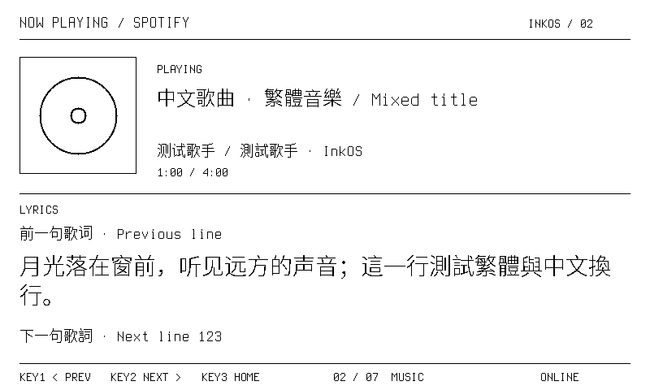
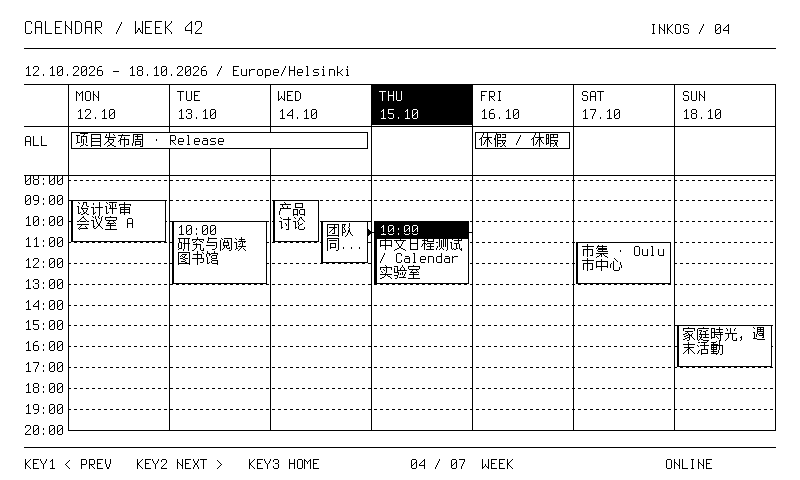

# 显示、字体与布局合同

## 像素合同

内部 framebuffer 为 800×480、48,000 bytes，每行 100 bytes。**1 白、0 黑**。Canvas、封面和 Panel 之间始终保持同一内部定义。PBM 文件的 bit polarity 与内部相反，/frame.pbm 导出时转换；不要为修截图而再次反转面板数据。

所有生产页面按整数像素绘制。文字不通过网页截图、JPEG、灰度缩放或浏览器字体替代。截图工具只把设备的 PBM 转为无损 PNG。

## 字体

| 字号 | 来源 | 用途 |
|---|---|---|
| 14 / 16 / 18 / 20 / 24 | Terminus 4.49.1 normal BDF | 标签、日期、日历和一般 UI |
| 28 / 32 / 48 / 76 / 96 | IBM Plex Mono Light | 温度、时钟和大号数值 |

小字直接使用原始点阵，一像素 H 竖笔画；大字离线按目标尺寸用 FreeType monochrome 生成。字库位于 assets/fonts，输出 firmware/InkOS/src/Fonts.cpp。不要手改生成数组。

生成命令：`python tools/generate_fonts.py`。Pillow/FreeType 版本不同可能改变大字体栅格化；重新生成要检查 diff 和实物，再决定是否更新资产。当前已验收字模作为基线，不应在纯布局修改中随意重生成。

0.4.2 加入全局中文 fallback，0.5 改用 Adobe 思源黑体 Source Han Sans SC Light 2.005。原有 ASCII、Latin-1、Latin Extended-A、芬兰字符、角度和欧元优先使用原字库；缺字时查找中文离线单色字模。每组含 28,430 个字形，涵盖基本多文种平面的简繁体汉字、扩展 A、兼容汉字、中文标点，以及假名和注音。Emoji 和补充平面的少见汉字尚未覆盖，仍以问号替代。

| 请求字号 | 中文字模／汉字前进宽度 |
|---|---|
| 14 / 16 | 14 px |
| 18 / 20 | 18 px |
| 24 | 24 px |
| 28 及以上 | 28 px |

中文前进宽度按实际 fallback 字模计算；英文数字保留原等宽宽度。`textWidth`、`fit`、`wrapped` 共用字形解析器，避免把汉字当半宽字符。日程窄块按完整 Unicode 字符换行，空间不足加省略号。歌曲元数据在 UTF-8 字符边界截断，非法编码安全退化。

思源黑体 Light 源字库、校验和及 OFL 许可证见 [字体来源](../assets/fonts/source-han-sans/SOURCE.md)。运行 `python tools/generate_cjk_fonts.py` 生成四档原生字模的共享归档 `out/assets/fonts.bin` 和身份校验头。归档无损压缩到约 3.99 MiB，全部位于内部 fonts 分区；运行时按块解压到 PSRAM 缓存；不整库加载进 RAM，详见 [OTA 资源布局](OTA.md)。生成时使用 FreeType monochrome，设备只画 1-bit 字形，不作灰度或运行时缩放。原有 `Fonts.cpp` 不重新生成；显示波形不变。

0.6 实机合成预览：[Music](images/source-han/music-chinese.png)、[Week](images/source-han/week-chinese.png)、[Home](images/source-han/home-chinese.png)。这些预览只含测试内容；原有英文 Home／Week 与历史基线逐像素一致。

## 布局约定

- 0.7 起左右外边距 12 px；公共标题 baseline 28，标题下线 y=42，正文延伸至 y=468。硬件分辨率仍为完整 800×480，移除所有底部按键栏。
- Home 中央分隔 x=456；右栏起点 x=476；正文与分隔线之间保留明确 gutter。两个世界时钟竖排在主时钟右侧，删除 UTC 偏移与重复日期。
- Home 底部天气／月相／太阳信息各有边界，月相和太阳之间存在专用竖线。
- 0.7.9：天气区下部显示接下来三天（星期、24 px 图标、高／低温）；月相图上移，下方显示本地计算的月出／月落时间（整天不升或不落时显示 ABOVE/BELOW HORIZON）。
- 0.7.10：下半区改为统一网格（列 12–236 / 236–336 / 336–436，数值基线 312/380/448，标签基线 288/356/424，留白 12 px，块从 y 256 到 464）；太阳列新增今夜最高 Kp（NOAA SWPC，MDI aurora 40 px）。
- 同一组信息保持固定字号、行距和对齐基线；大数值、分组标签、次要信息各有层次。
- 月历按当月实际周数排布；今天填黑，节日与旗日保留独立标记。WK 数字与日期均为 18 px、同基线，周序号用一像素水平加重。
- fit 用省略号裁文字，不能为了塞进字段而任意压缩字体。
- Week 事件网格最多并排两列，溢出用日期表头 +N 提示；中文标题按像素宽度换行。

详细页面坐标在 renderer 中，公共关键边界在 Layout.h。新增布局先使用原字体，避免同时改动文字栅格与位置而难以定位问题。

## 刷新策略

0.6.1 起，按键、USB、IP 与上位机切页共用两阶段导航：先只局刷左上角标题（0.7 为 12..299 列，正文和价格不变），标题完成显示后等待默认 500 ms，再全刷选中的页面。连续按键重新选择并计时，等待期间暂停正文更新；显示任务只跟踪最新选择，不排队刷新中间页。即使返回原页，已经显示过预览也会在停按后完整重绘，清除标题局刷痕迹。

Studio 的 Device → Page selection delay 可设置 0.1–5 秒，点击 Save to screen 保存。计时基于单调时钟，与 NTP 校时无关；工厂局刷本身约 1.1 秒，不包含在设置的等待时间中。已启动的物理刷新无法取消，刷新期间的新按键会在其完成后继续处理。导航预览暂不触发维护全刷，最终页面全刷会清零维护计数；没有启用短 LUT。

Panel 是唯一拥有 SPI 的模块，Display 是唯一调用它的任务。每次提交比较 old/new framebuffer，变化矩形扩展到字节边界并适当留边。页面、设置和封面变化可以强制全刷。

目前只用工厂 OTP 波形。PT_SCAN=0 限制窗口外 gate 扫描，每次刷新后关闭驱动电源。启动先白屏全刷，再显示页面；后续全刷实测约 4.2 秒，工厂局刷约 1.1 秒。温度和面板差异可能改变耗时。

维护预算为 Music 32 次内容局刷、其他内容 60 次、动画 1200 次，或距上次全刷超过 30 分钟。预算会触发维护全刷，因此不能承诺一直无闪烁。

## 为什么默认关闭快刷

早期使用短 LUT 做快速动画，用户观察到只有持续更新的符号较黑，静态字变淡，白底变脏。仅缩小窗口和刷新后断电还不足以改善，最终停用了短波形。

默认 animations=false：冒号常亮、天气图标静止、时钟按分钟变动。打开 Frequent Home updates 会恢复动画目标与冒号切换，但实际速率受工厂波形控制，不保证 0.5 秒更新。歌词仍可局刷，也使用工厂波形。

Frame PNG 只能确认几何、黑白像素和是否缺字，不能证明屏幕对比度、残影、长时间漂移或不同温度表现。任何波形或高频策略修改都需要独立实物反馈。


## 中文合成预览（0.4.2）

以下图片由设备正式绘图器生成，使用合成的歌曲、歌词与日程，不含真实账号内容。





[首页中文下一事项](images/chinese/home-chinese.png)。启动检查覆盖字宽、换行、省略、UTF-8 边界、字形差异与反白；英文 Home／Week 合成场景与 0.4.1 按像素比较一致。


## 0.7 公共状态与天气图标

天气页标题统一为 `WEATHER / 地点`，切页标题预览使用相同格式。所有页右上角统一显示 ADC 估计的电池填充／百分比（无电池或异常读数时显示电池加斜线、隐藏百分比）及 Wi-Fi 三层强度，断线画斜杠。Home 月相只保留图示，太阳只显示前后事件图标和时间；两个世界时钟位于主时钟右边。Music、Weather、Agenda、Moon、Sun、Energy 均按新增正文空间重新安排，没有整体缩放画布。

0.7.0–0.7.4 天气采用 [Pictogrammers MDI 7.4.47](https://pictogrammers.com/library/mdi/) 的 13 类 SVG，按 WMO 天气码和日夜状态选用。历史原始资源与许可见 [MDI 来源](../assets/icons/mdi/SOURCE.md)。0.7.5 起使用下述 Lucide 细线图标；动画仍需显式开启，默认静态以维护对比度。

### 0.7.1 rotation responsiveness

GPIO interrupts capture full quadrature detents. A dedicated input task (2 ms target cadence, at least one RTOS tick) publishes them independently of the HTTP/USB control task. Fast bursts are coalesced for 25 ms of input silence or at most 80 ms from the first pending title request. Only the latest selection is rendered, rechecked before sending to the panel; in-flight physical waveforms finish normally. The original verified OTP partial waveform is unchanged, so panel refresh time remains the hardware limit.

After the title is visible and the configured selection delay expires, the final revision check arms `encoder_lock_ms` (default 2000). Rotation is discarded during this interval, including pending counts and partial cycles at the boundary. The interval starts before the full refresh; it does not add another two seconds after refresh completion. Home remains available.

### 0.7.2 scheduling (supersedes 0.7.1 timing)

The first target title is dispatched immediately; requests received during a physical waveform collapse into the latest target. The configured quiet interval now starts at the last input and overlaps the title refresh. Once quiet time has elapsed and the final title has been physically visible for 100 ms, the prepared full page is accepted. A setting of 500 ms no longer adds another 500 ms after a ~1-second title waveform. The encoder-only lock still begins at full-page acceptance.

The display task first reads a small metadata snapshot, only copies the 99 KB model when a page actually needs rendering, and reuses a frame prepared during quiet time if its render identity is unchanged. Background redraw requests are coalesced for 40 ms with a 150 ms maximum; navigation bypasses this delay. A final navigation revision check prevents a background frame superseded during rendering from reaching the panel. Already-triggered panel waveforms cannot be cancelled.

### 0.7.3 experimental ~0.3-second title preview

At the user's request, navigation titles trial a short register LUT. The change is restricted to `RefreshMode::Navigation` and a guarded, byte-aligned header region x=8..303, y=4..34. Any diff outside it falls back to OTP. UC8179 register LUT tables are fully cleared (60-byte R20/R22/R23/R24 and 42-byte R21/R25), with balanced one-frame differential transitions; border Hi-Z, PT_SCAN=0, end-of-waveform VCOM float and power-off are retained. Panel voltages and PLL are not changed.

Normal clock/weather/lyrics partials and full refresh explicitly select the original OTP waveform. Stopping selection still leads to a normal full refresh. Firmware 0.7.2 and its OTA archive remain available for rollback. The target is approximately 0.3 seconds for the complete title presentation, not a guarantee independent of panel/temperature. Host timing and controller BUSY verify speed; framebuffer PNGs cannot verify contrast or residual ghosting. This is an optical experiment awaiting user observation, not a claim of long-term visual acceptance.

### 0.7.4 experimental ~0.5-second title preview

The user rejected the 0.7.3 one-frame waveform: old characters remained visible. Firmware 0.7.4 extends both active differential phases to six frames. This increases the physical erase/write pulse duration while preserving their balance; it does not add an artificial post-refresh wait. The guarded title rectangle, unchanged voltages/PLL, full-length LUT writes, gate-window scan, power-off, factory body/full modes, selection delay and encoder lock are retained. Four measured title presentations took 483 ms each. The user accepted the resulting appearance; this does not establish long-term panel behavior at other temperatures.

### 0.7.5 thin rounded weather symbols

Home and Weather use a unified outlined family adapted from pinned [Lucide sources](../assets/icons/lucide/SOURCE.md), following the user's reference. Native 16/24/40/64 px masks use target strokes of 1/1/1.25/2 px with rounded ends and joins. Original SVGs stay unchanged; the generator strokes them offline at higher resolution, then thresholds once to strictly black/white pixels. The device draws masks directly without scaling, SVG parsing or grey antialiasing. Temperature, precipitation and wind metrics use matching symbols. Text fonts, layout hierarchy and the accepted navigation waveform remain unchanged.

### 0.7.6 experimental faster navigation refresh

`INKOS display` 行新增 `on_us/xfer_us/wave_us/off_us/total_us` 与 `power=held|off|reused-off`，`status` 命令返回 `display_phase_us`。导航标题后面板保持上电，后续标题或选定页全刷直接复用；其他刷新先断电；空闲 `idle_off_ms`（默认 3000 ms）后强制断电。选定页全刷改用快速 OTP 全刷（E0=0x02、E5=0x5A，日志 `wave=otp-fast`），开机、恢复和维护全刷仍为标准 OTP；连续 8 次快速全刷后下一次用标准全刷，30 分钟维护以最后一次标准全刷计时。

调节与回退（USB 或已配对 IP）：

```json
{"cmd":"display_tuning_get"}
{"cmd":"display_tuning_set","hold_power":false,"fast_full":false,"idle_off_ms":3000}
```

残影、低温和长时间保持驱动电压的影响需要实物验收。
