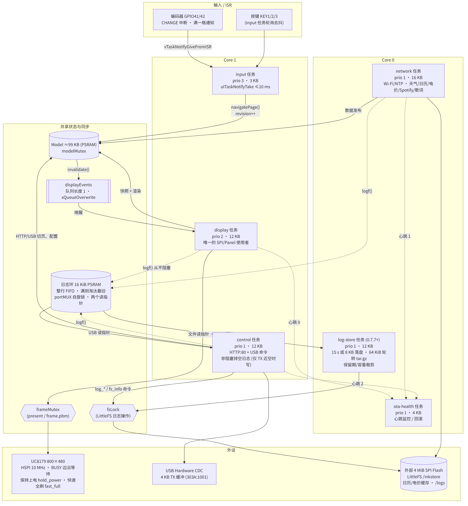
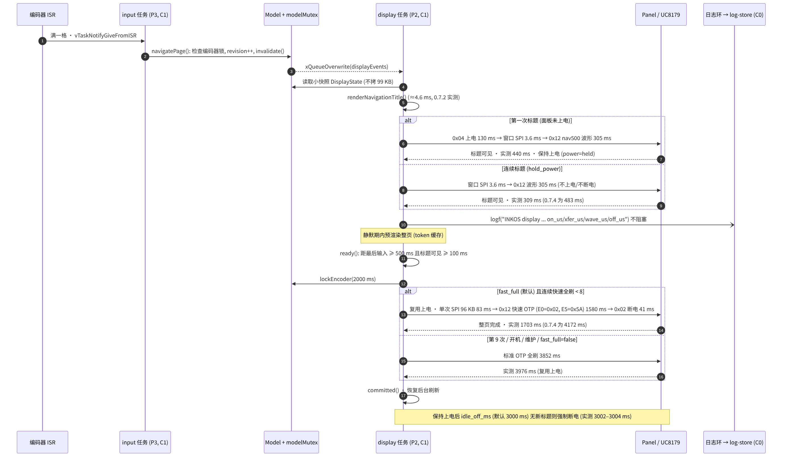
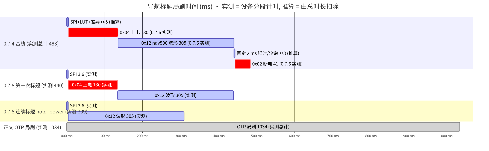
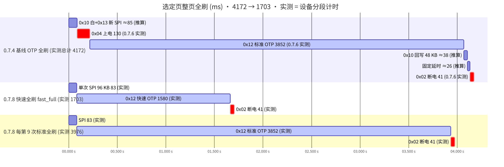

# 交接说明（固件 0.7.8 / Studio 0.7.4）

本文汇总 0.7.6–0.7.8 的性能与日志工作，供接手者快速了解当前状态、设计、操作方法和尚未完成的验证。细节分别见 [ARCHITECTURE](ARCHITECTURE.md)、[DISPLAY](DISPLAY.md)、[LOGS](LOGS.md)、[OTA](OTA.md) 和 [BUILD](BUILD.md)。

## 1. 当前版本

| 项目 | 版本 | 说明 |
|---|---|---|
| 固件 | **0.7.8** | `firmware/InkOS/src/Ota.cpp` 的 `VERSION`，`Runtime.cpp` 启动横幅 |
| Studio | **0.7.4** | `desktop/InkOS.Studio/InkOS.Studio.csproj` 的 `<Version>` |
| 工具链 | Arduino-ESP32 **3.3.12**，.NET **10**，Python 3.11+ | FQBN `esp32:esp32:XIAO_ESP32S3_Plus:PSRAM=opi,CDCOnBoot=default,USBMode=hwcdc` |
| 分区 | `inkos-ab594-extfs-v2` | 两个 5.9375 MiB A/B 应用槽、内部 4 MiB 字库、外部 4 MiB LittleFS |

参考设备：0.7.10 运行在 ota_1 并已确认健康，0.7.9 保留在 ota_0；日志开启，保留期 35 天。

## 2. 架构摘要



源文件：[1-architecture.mmd](images/architecture/1-architecture.mmd)

| 任务 | 核心 / 优先级 / 栈 | 职责 |
|---|---|---|
| input | core 1 / 3 / 3 KB | 编码器 ISR 通知（`vTaskNotifyGiveFromISR`），按键轮询，`navigatePage()` |
| display | core 1 / 2 / 12 KB | 快照、渲染、唯一的 SPI/Panel 使用者 |
| control | core 1 / 1 / 12 KB | USB NDJSON 命令、本地 HTTP、电池 ADC、**非阻塞排空日志到 USB** |
| network | core 0 / 1 / 16 KB | Wi-Fi/NTP、天气、日历、电价、Spotify、歌词 |
| log-store | core 0 / 1 / 12 KB | 日志落盘、tar.gz 轮转、保留期与容量裁剪（0.7.7 起） |
| ota-health | core 0 / 1 / 4 KB | 任务心跳、启动健康确认、回滚 |

同步原语：

- `modelMutex`：保护约 99 KB 的 PSRAM Model，只做短时快照与发布，网络请求和面板 I/O 期间不持有。
- `displayEvents`：长度为 1 的队列，`xQueueOverwrite` 合并重绘请求，只保留最新状态。
- `frameMutex`：保护当前帧（present 与 `/frame.pbm` 抓取）。
- 编码器状态与锁定截止时间：ISR 安全的 `portMUX` 临界区。
- 日志环：`portMUX` 自旋锁只包住一次 memcpy；两个独立读指针（USB、文件）。
- `fsLock`：串行化 LittleFS 日志操作（落盘、轮转、裁剪、`log_*` 与 `fs_info` 命令）。

### 切页流程



源文件：[2-page-switch-sequence.mmd](images/architecture/2-page-switch-sequence.mmd)

1. 编码器满一格，ISR 直接通知 input 任务；`navigatePage()` 检查编码器锁，递增 revision，写入 `displayEvents`。
2. display 只读取小快照 `DisplayState`（不复制 99 KB Model），渲染标题（约 4.6 ms），对标题窗口做导航局刷（nav500 波形）。
3. 面板保持上电（`hold_power`）：连续标题不再上电／断电。
4. 停按后静默期内预渲染整页；距最后输入 ≥ 500 ms（可配置）且标题已可见 ≥ 100 ms 时，锁定编码器 2000 ms，提交整页。
5. 整页用快速 OTP 全刷（`fast_full`），复用已上电状态，结束后断电；每连续 8 次快速全刷后用一次标准全刷。
6. 保持上电后 `idle_off_ms`（默认 3000 ms）内无新标题则强制断电。

### 刷新时间预算（设备分段计时，实测）

| 场景 | 0.7.4 | 0.7.8 | 分段（0.7.8） |
|---|---|---|---|
| 连续标题 | **483 ms** | **309 ms** | SPI 3.6 + 波形 305.2，无上电／断电 |
| 第一次标题 | 483 ms | 440 ms | 上电 130.3 + SPI 3.6 + 波形 305.3 |
| 选定页全刷 | **4172 ms** | **1703 ms** | SPI 83.0 + 快速 OTP 1579.6 + 断电 40.8 |
| 第 9 次标准全刷 | — | 3976 ms | SPI 83.0 + 标准 OTP 3851.9 + 断电 40.8 |
| 请求到提交（中位数） | 4780 ms | 2266 ms | — |
| 两个开关都关闭 | — | 标题 480 / 全刷 4106 ms | 只保留 SPI/BUSY 优化 |
| 正文 OTP 局刷 | 1034 ms | 1034 ms | 未改动 |





源文件：[3-refresh-timeline.mmd](images/architecture/3-refresh-timeline.mmd)、[4-full-refresh-timeline.mmd](images/architecture/4-full-refresh-timeline.mmd)。图中“实测”为设备 `on_us/xfer_us/wave_us/off_us` 计时；0.7.4 基线的分段取自 0.7.6 关闭开关时的实测，SPI、固定延时和 DTM1 回写为由总时长扣除的推算值。原始记录见 [validation/0.7.6-navigation.json](validation/0.7.6-navigation.json)。

## 3. 串口日志卡顿的根因

现象：0.7.x（0.7.4 也有）插着 USB 一段时间后，切页标题和整页刷新会持续慢好几秒，直到重启。

根因：Hardware CDC 的 USB 发送缓冲只有 4 KB。USB 插着但电脑上没有程序读取串口时，缓冲很快写满；之后 display、network 任务里的每条诊断 `Serial.printf` 都要等待背压超时（每次最长约 2 s）。一次刷新期间打印多行，延迟就累积到数秒，而且缓冲一直是满的，所以“粘滞”。

修复（0.7.6）：任务不再直接写串口。`logf()` 把整行写入 16 KiB PSRAM FIFO，满时淘汰最旧行，从不阻塞；只有 control 任务在发送缓冲接近空时（即确有主机在读）把日志写到 USB。之后打开串口仍能按顺序读到最近保留的行。命令回复格式不变。

## 4. 日志子系统

完整说明见 [LOGS](LOGS.md)。

- 通路：`logf()` → 16 KiB 日志环 → USB 读指针（control）／文件读指针（log-store）→ `/logs/current.log` → 64 KiB 轮转为 `inkos-NNNNNN.tar.gz`（标准 ustar + gzip，ROM miniz）。
- 落盘：每 15 s 或积累 8 KiB；单批最多 16 KiB。实测轮转 66,404 → 6,864 B，用时 297 ms（core 0），对刷新无可见影响。
- 保留与上限：保留期（默认 35 天，仅在时钟有效时按时间删）→ 最多 300 个归档 → 预算 50 % ×（总量 − 512 KiB − 非日志数据，≥ 256 KiB）→ 始终保留 512 KiB 空闲。最旧的先删；空间仍不足时丢弃新批次。
- 裁剪时机：开机、每次轮转、设置变更；日志开启时每天一次。关闭日志时无周期唤醒、不写 Flash。
- 容量（实测）：LittleFS 4,194,304 B；清空日志后已用 61,440 B；预算 1,804,288 B；约 36 KB/天压缩日志，约可保存 42 天。90／180 天保留期由空间上限先删旧日志，Studio 会提示。
- 字库不在 LittleFS：内部 fonts 分区 4,185,866 / 4,194,304 B。

## 5. 新命令与设置

| 命令 / 设置 | 版本 | 说明 |
|---|---|---|
| `display_tuning_get` / `display_tuning_set` | 0.7.6 | `hold_power`、`fast_full`（默认 true）、`idle_off_ms`（默认 3000），各自独立 NVS 键 |
| `status.display_phase_us`、`status.log_dropped`、`log_buffered` | 0.7.6 | 最近一次刷新分段计时，日志环统计 |
| `logging_get` / `logging_set` | 0.7.7 / 0.7.8 | `enabled`（NVS `log_on`，默认开）与 `retention_days`（NVS `log_ret`，7/21/35/90/180，默认 35）；不触发整屏刷新 |
| `log_list`、`log_read`、`log_tail`、`log_rotate`、`log_clear` | 0.7.7 | 列表、分块读取、尾部、立即轮转、清空 |
| `log_delete` | 0.7.8 | `name` 或 `names[]`，仅 `/logs/` 下的日志文件，整批校验 |
| `fs_info` | 0.7.8 | LittleFS 与字库分区用量、分类、目录、日志预算 |
| `settings_get/set` 字段 `logging_enabled`、`log_retention_days` | 0.7.7 / 0.7.8 | 可选；缺省不变，旧 Studio 不会覆盖 |

全部命令同时支持 USB 与已配对 IP。

## 6. 构建、测试、烧录与回滚

构建与测试：

```powershell
python -m pip install -r tools/requirements.txt
python -m unittest discover -s tests -v     # 含主机编译的日志环与 LogPolicy（伪时钟）测试
python tools/check_repo.py                   # 链接、禁止产物与凭据模式检查
python tools/build.py                        # 默认 Hardware CDC；不再有 --usb-otg
dotnet build desktop/InkOS.Studio/InkOS.Studio.csproj -c Release
dotnet publish desktop/InkOS.Studio/InkOS.Studio.csproj -c Release -r win-x64 --self-contained true -o out/studio
python tools/package.py --firmware out/firmware --studio out/studio --bridge out/storage-bridge/storage_bridge.ino.bin
```

Studio 检查模式：`"InkOS Studio.exe" --self-test`（离线，14/14）；`--logs-smoke --port COMx`（访问真实设备的日志功能，不发送 `settings_set`，结束时恢复保留期）。`--device-smoke`、`--network-smoke` 会写回设置，只在准备好的测试设备上使用。

烧录（安全 A/B OTA 路径）：

1. 先确认 `ota_info` 显示 `healthy=true`，记下当前槽位和版本；保留上一版 `InkOS-OTA-<ver>.zip` 作为回退包。
2. 已配对 IP：Studio → Network → Firmware 选择 `InkOS-OTA-0.7.8.zip`，或 `python tools/ota.py install --ip <设备IP> --package out/release-0.7.8/InkOS-OTA-0.7.8.zip`。
3. USB：同一组 `ota_begin` / `ota_chunk` / `ota_finish` 命令也可经 USB 串口发送（本次 0.7.6–0.7.8 均如此安装）。设备只写入非活动槽，校验 SHA-256 与镜像后切换并重启。
4. 新镜像处于 PENDING_VERIFY，直到启动自检、字库、外部文件系统、首帧和各任务心跳持续 30 s 正常才确认；未确认的重启由 bootloader 自动回滚，90 s 健康失败也会主动回滚。
5. 不要整片擦除 Flash，不要烧录 merged.bin，不要把 boot_app0 写到 0xe000；普通 OTA 不改动 NVS、字库、LittleFS、bootloader 和分区表。

回滚：再用同样的 OTA 路径安装上一版 OTA 包（例如 0.7.7c 或 0.7.5），它会写入另一个槽。仅需关闭新行为时不必回滚，见下一节的开关。回滚不会撤销 NVS 新键（`log_ret` 等），旧固件会忽略它们。

## 7. 运行时开关

```json
{"cmd":"display_tuning_get"}
{"cmd":"display_tuning_set","hold_power":false,"fast_full":false,"idle_off_ms":3000}
{"cmd":"logging_get"}
{"cmd":"logging_set","enabled":false}
{"cmd":"logging_set","retention_days":35}
```

- `hold_power=false`：每次刷新后都断电（标题约 480 ms）。
- `fast_full=false`：选定页全部使用标准 OTP 全刷（约 4.1 s）。
- `logging_set enabled=false`：停止记录与日志 Flash 写入，立即生效。

## 8. 待办与实物验证清单

- [ ] **残影**：长时间使用快速全刷（每 8 次插入一次标准全刷）后检查静态文字和背景是否变脏。
- [ ] **低温**：快速 OTP 全刷与 nav500 标题在低温下的对比度和完整擦除。
- [ ] **长时间保持驱动电压**：连续切页时面板保持上电，最长到 `idle_off_ms`；需观察长期影响。
- [ ] **IP 日志命令**：`log_*`、`fs_info`、`logging_set` 已在 USB 上实测；经已配对 IP 的调用共用同一分发，但尚未实机测试。
- [ ] **可选 20 MHz SPI**：目前保持 10 MHz；全帧 SPI 约 83 ms，提速最多节省约 40 ms，需验证信号完整性。
- [x] **USB-OTG 日志盘**：已决定不做；保持 Hardware CDC，避免改变 COM 口与 esptool 复位流程。
- [ ] 按实际使用量复核日志容量估算（频繁切页会提高日志速率）。

## 9. 关键源文件

| 文件 | 内容 |
|---|---|
| `firmware/InkOS/src/Runtime.cpp` | 任务创建、display/control/input 循环、切页调度、`status` |
| `firmware/InkOS/src/Panel.h/.cpp` | UC8179 驱动、上电保持、快速全刷、分段计时、BUSY 等待 |
| `firmware/InkOS/src/NavigationWaveform.h` | nav500 标题 LUT |
| `firmware/InkOS/src/PageNavigation.h`、`RenderSchedule.h` | 选页状态、静默期、后台合并 |
| `firmware/InkOS/src/Hardware.cpp` | 编码器 ISR、按键、ADC |
| `firmware/InkOS/src/Log.h/.cpp` | 16 KiB 日志环、`logf`、两个读指针、USB 排空 |
| `firmware/InkOS/src/LogStore.h/.cpp` | log-store 任务、落盘、tar.gz 轮转、`log_*` 与 `fs_info` 命令 |
| `firmware/InkOS/src/LogPolicy.h/.cpp` | 日志名校验、保留期选项、预算、裁剪规划（纯函数） |
| `firmware/InkOS/src/Configuration.cpp`、`Services.h` | 设置、NVS 键、`logging_set`、`display_tuning_*` |
| `firmware/InkOS/src/Storage.cpp`、`Ota.cpp` | 外部 LittleFS、A/B OTA 与健康确认 |
| `tests/host/log_ring_test.cpp`、`log_policy_test.cpp`、`tests/test_host_firmware.py` | 主机测试 |
| `desktop/InkOS.Studio/MainViewModel.Logs.cs`、`Views/LogsView.axaml` | Studio Logs 页 |
| `desktop/InkOS.Studio/LogStorage.cs`、`LogArchive.cs`、`LogChecks.cs` | 存储解析与容量估算、tar.gz 解压、`--logs-smoke` |
| `desktop/InkOS.Studio/DeviceClient.cs` | USB／IP 命令客户端 |
| `tools/build.py`、`tools/package.py`、`tools/ota.py` | 构建、打包、IP OTA |
| `docs/images/architecture/*.mmd` | 本文图表源文件（mermaid-cli 渲染为 PNG） |
