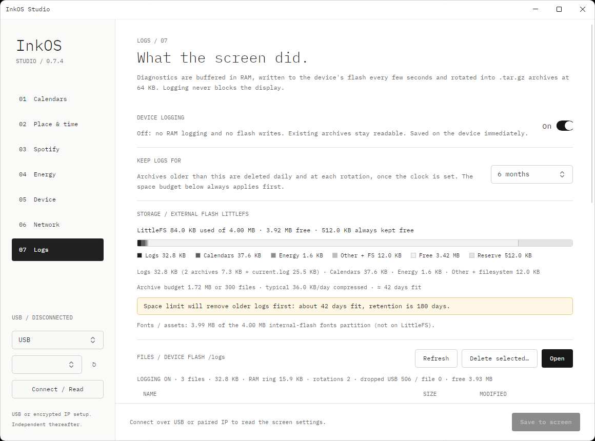

# 设备日志（固件 0.7.8 / Studio 0.7.4）

InkOS 把 `INKOS ...` 诊断行（刷新计时、导航、Wi-Fi、天气、日历、电价、OTA）保存在设备上，之后可经 USB 或已配对 IP 读取。USB 保持 Hardware CDC 模式，不提供 USB 存储盘。

## 数据通路

```
logf()  ──►  16 KiB PSRAM 整行日志环（从不阻塞，满则淘汰最旧行）
              ├─ USB 读指针：control 任务仅在主机读取时写入串口
              └─ 文件读指针："log-store" 任务（core 0，优先级 1）─► /logs/current.log
                                                              └─ 满 64 KiB ─► /logs/inkos-NNNNNN.tar.gz
```

- **写入方从不阻塞。** `logf` 在栈上格式化最多 320 字节，在自旋锁内拷贝进日志环；环满时淘汰最旧的完整行。两个读指针相互独立，各自统计未读即被淘汰的行数（USB 为 `dropped`，Flash 为 `file_dropped`）。
- **USB 排空**在 control 任务中进行，只在 4 KiB 发送缓冲接近空（主机正在读取）时写入，所以插着 USB 但没人读串口时不会拖慢任何任务。命令回复与启动横幅由同一任务输出，不会与日志行交错。
- **Flash 写入任务**（`log-store`，12 KiB 栈，从不获取 frameMutex）每 15 s 或积累 8 KiB 时唤醒，把一批（最多 16 KiB，PSRAM）追加到外部 LittleFS 的 `/logs/current.log`，需要时轮转。display 任务从不为日志访问 Flash。
- **轮转**在 64 KiB 时进行：把 `current.log` 流式写入 `/logs/.rotate.tmp`，格式为标准 ustar（单个成员 `inkos-NNNNNN.log`，权限 0644，属主 `inkos`），用 ROM miniz 压缩器（`tdefl`，128 probes，约 170 KB 状态位于 PSRAM）封装为标准 gzip（头部、raw deflate、CRC-32 与长度），再改名为 `inkos-NNNNNN.tar.gz` 并删除 `current.log`。实测 66,404 → 6,864 字节（10.3 %），core 0 用时 297 ms；在连续切页期间进行，对标题和全刷无可见影响。
- **保留与裁剪**（纯规则位于 `LogPolicy.cpp`，有主机测试），最旧的归档先删：
  1. 轮转时间早于 `log_retention_days`（7/21/35/90/180，默认 **35**）的归档；仅在 NTP 校准时钟后执行，时钟未设置前轮转的归档没有时间，不按时间删除；
  2. 最多 **300** 个归档，且归档总量不超过预算 = **50 %** ×（LittleFS 容量 − 512 KiB 余量 − 非日志数据），至少 256 KiB；预算按 4 KiB 块取整计算；
  3. 始终保留至少 **512 KiB** 空闲（日历／电价缓存）。空间不足时先删最旧的归档，仍不足则丢弃新批次（`discarded_batches`）。

  裁剪时机：开机、每次轮转、日志设置变更，以及日志开启时每天一次。关闭日志时没有周期唤醒，只在开机和设置变更时裁剪。归档时间取文件 mtime，缺失时取 gzip 头部 MTIME。轮转持续失败时，`current.log` 超过 128 KiB 会被删除。

归档可用任意 tar 打开：`tar -xzf inkos-000002.tar.gz`（Windows 10 起自带 `tar.exe`）。

## 存储容量（设备实测，0.7.8）

- LittleFS 位于外部 4 MiB SPI Flash：4,194,304 字节，4 KiB 块。通常已用约 84 KiB：日历约 38 KB、电价约 1.6 KB、日志，以及块取整与元数据。清空日志后已用 61,440 字节。
- 字体资源**不在** LittleFS 上：内部 `fonts` 分区 4,194,304 字节中占用 4,185,866 字节。
- 按当前数据计算的归档预算：1,804,288 字节（1.72 MiB）。
- 空闲时原始日志约 4 B/s（约 350 KB/天：分钟时钟刷新、天气、日历）；归档压缩到约 10 %，即约 36 KB/天，每个 64 KB 归档约 6.8 KB（按 4 KiB 块占 8 KiB）。预算可容纳约 220 个归档，约 **41–42 天**（达不到 300 个文件上限）。1、3、5 周可以完整保存；按此速率 3 个月和 6 个月存不下，频繁切页会产生更多日志。由空间上限先删除旧归档；当估算天数小于所选保留期时，Studio 显示提示。

`fs_info` 返回 `littlefs`（total/used/free/block/reserve）、`categories`（logs、calendars、energy、other 的字节与文件数）、`dirs`（各顶层目录）、`log`（当前／归档字节、归档数、最旧／最新归档时间、预算、文件上限、预算比例、轮转大小、保留期、时钟是否有效、已裁剪数）和 `fonts`（分区大小、已用）。在日志锁内对小目录树做一次遍历。

## 设置

`log_retention_days`（NVS `log_ret`，默认 35）：`logging_set {"retention_days":N}` 立即应用并裁剪；`settings_get`／`settings_set` 可选携带；`status` 报告当前值。只接受 7、21、35、90、180。

`logging_enabled`（NVS `log_on`），**默认开启**。关闭后 `logf` 立即返回，日志环保持原状，写入任务无周期唤醒、不写 Flash。关闭时先记录 `INKOS logging disabled` 并落盘待写行；开启时记录 `INKOS logging enabled`。立即生效，无需重启。两项设置均已验证可跨重启保持。

- `{"cmd":"logging_set","enabled":false,"retention_days":35}`（两个字段均可选）／`{"cmd":"logging_get"}`：读写时不增加设置 revision，不触发整屏刷新。Studio 的开关和下拉框使用这一命令。
- `settings_get` 报告 `settings.logging_enabled` 与 `settings.log_retention_days`；`settings_set` 可选接受（缺省即不变，旧版 Studio 不会覆盖设备值）。
- `status` 报告 `logging_enabled`、`log_retention_days`、`log_dropped`、`log_file_dropped`、`log_buffered`。

## 命令（USB 与已配对 IP）

| 命令 | 参数 | 返回 |
|---|---|---|
| `log_list` | — | `enabled`、`storage`、`ring_bytes`、`pending_bytes`、`dropped`、`file_dropped`、`discarded_batches`、`rotations`、`rotate_bytes`、`retention_days`、`pruned`、`rotate_error`、`fs_free_bytes`、`files[{name,size,mtime}]`（归档按序号排列，`current.log` 在最后） |
| `log_read` | `name`、`offset`、`length` ≤ 2048 | `data`（base64）、`length`、`size`、`eof` |
| `log_tail` | `bytes` ≤ 3072 | 日志环中最新的完整行，base64 `data` |
| `log_rotate` | — | 立即归档 `current.log`（不限大小） |
| `log_delete` | `name` 或 `names[]`（≤ 64）：`current.log`、`inkos-NNNNNN.tar.gz`，可带 `/logs/` 前缀 | `deleted[]`、`missing[]`；其他路径（`..`、其他目录、其他文件）使整批请求被拒绝 |
| `log_clear` | `files`（默认 true） | 清空日志环；删除全部日志文件 |
| `fs_info` | — | 上述存储明细 |

删除 `current.log` 时持有写入任务的锁，不会与落盘或轮转竞争；下一次落盘用内存中尚未写出的行重建该文件。

`mtime` 为 Unix 秒（UTC），NTP 校准前为 0。

## Studio Logs 页



Studio 0.7.4 的 **07 Logs**：设备日志开关、保留期下拉框（立即应用）、LittleFS 用量条（日志／日历／电价／其他／空闲／余量）、字库分区、容量估算与 “space limit will remove older logs first” 提示、可多选的文件列表（大小、修改时间）及 **Delete selected…**（行内确认）和 **Clear all**。Open 用 `log_read` 下载并以 `System.Formats.Tar` + `GZipStream` 解压 `.tar.gz`；支持不区分大小写的行过滤、实时尾随（每 2 s 轮询 `log_tail` 并合并重叠部分）、Save（按设备存储原样保存；尾随内容保存为文本）。

`--logs-smoke [--port COM9]` 用同一套代码检查真实屏幕：关闭／开启日志并确认关闭期间日志环不增长；读取尾部；设置保留期并在结束时（包括失败时）恢复；创建三个归档并核对 `fs_info`；下载并解压一个归档；确认设备端执行路径校验；删除两个所选归档和 `current.log`；清空全部，并在每一步核对数字。它从不发送 `settings_set`。
