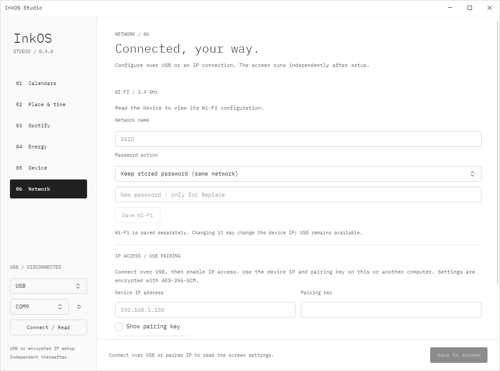

# Wi-Fi 与 IP 配置

固件和 Studio **0.4.0** 增加 Network 设置区，以及与 USB 共用命令处理器的 IP 传输。ShadUI、IBM Plex Mono 字体和显示刷新策略保持不变。

## 首次配网

1. USB 连接设备，在 Studio 左侧选择 USB 和实际串口，点击 Connect / Read。
2. 打开 Network，填写 2.4 GHz 网络名称。
3. 选择 Replace password 并输入密码，或明确选择 Open network。
4. 点击 **Save Wi-Fi**。这与底部 Save to screen 分开，避免保存其他设置时意外切断网络。
5. 等待联网，再 Connect / Read。Network 中显示设备 IP。

SSID 按 UTF-8 编码限制为 1–32 bytes；密码为 8–63 bytes。Keep stored password 仅用于相同 SSID；设备从不返回密码。保存采用独立 NVS JSON 项 `wifi/network1`，旧版 `ssid/pass` 仍可迁移读取。密码修改后，即使 SSID 不变也会重新连接。保存回执先返回，约 1.5 秒后允许网络任务应用配置；网络任务正在请求外部数据时可能稍晚。

错误网络或密码不会清除 USB 配置入口。当前不提供自动回滚或临时 AP；设备离线时通过 USB 修正。

## 使用 IP

1. 保持 USB 连接，Network → **Enable / replace key**。
2. 设备生成 256-bit 配对密钥，保存在 NVS。上位机仅在内存中持有密钥；勾选 Show pairing key 可复制到个人密码管理器或另一台电脑。
3. 左侧连接方式改为 **IP / Network**，填设备 IP 和密钥，点击 Connect / Read。
4. 日历、地区、世界时钟、天气、Spotify、电价、Wi-Fi 和切页均通过同一套页面和命令使用。

第一次必须 USB 配对。另一台电脑只需 IP、密钥和 Studio；无需接 USB，无需常驻电脑服务。Spotify 授权仍在运行 Studio 的电脑临时接收本机 OAuth callback，然后将令牌加密传给设备。

更换 Wi-Fi 可能使 DHCP IP 改变，Studio 保存成功后会断开 IP 连接。到路由器查看新地址，或用 USB 重新读取。建议在路由器设置 DHCP 保留地址。跨网络访问使用 VPN；本版本不自动配置端口映射、公网发现、OTA 或远程首次配网。

## 配对权限

IP 配置默认关闭。Enable / replace key 每次生成新密钥，旧密钥立即失效；Disable IP access 删除密钥并停止接受加密命令。这两项均只允许 USB 执行。配对密钥允许读取日历订阅地址、修改所有设备设置和更新 Spotify 凭据，应按设备管理员凭据保管。

Wi-Fi 密码、Spotify refresh token、电价 API key 不通过配置读取接口返回。私密日历订阅地址必须回读给编辑器，但仅通过 USB 或已配对的加密通道返回。不要将密钥或任何私人配置提交到仓库。

## 传输协议

HTTP 只是承载层；设置和凭据采用 AES-256-GCM 加密并校验，不能使用普通 JSON 直接 POST 设置。请求和响应使用独立随机 12-byte nonce、16-byte authentication tag；AAD 包含协议、challenge 和方向。ESP32 使用 Mbed TLS，Studio 使用 .NET AesGcm。

1. GET `/api/challenge` 返回 `protocol=inkos-config-v1` 和随机 16-byte challenge 的 32 字符 hex；未配对返回 403。
2. POST `/api/command`，JSON 字段为 `challenge`、`nonce`、`ciphertext`、`tag`；后二进制字段及 nonce 均 Base64。解密后的请求是原 USB 命令 JSON，最多 4095 bytes。
3. 请求 AAD：UTF-8 `inkos-config-v1|{challenge}|request`。验证成功后消耗 challenge，再执行命令；同一请求重放返回 401。
4. 响应字段 `nonce`、`ciphertext`、`tag`，响应 AAD 为 `inkos-config-v1|{challenge}|response`。回执和私密设置均在密文中。

设备最多保留四个未使用 challenge，30 秒过期；重启或更换密钥会清空。此设计限制重放，但不能防止局域网攻击者阻断连接或耗尽 challenge。现有 `/status`、framebuffer 和切页调试端点仍是局域网明文接口；配对只保护新增配置通道，并不将整台设备变成公开互联网服务。

实现位置：`RemoteConfiguration.cpp` 管理配对和网络信封；`executeCommand` 统一 USB/IP 命令分发；`Configuration.cpp` 管理校验和 NVS；桌面 `DeviceClient` 统一命令，`UsbTransport` 和 `NetworkTransport` 分别处理传输。

参考：[Mbed TLS GCM API](https://mbed-tls.readthedocs.io/projects/api/en/v3.6.3/api/file/gcm_8h/)。加密使用 crypt_and_tag，解密使用验证标签的 auth_decrypt。
