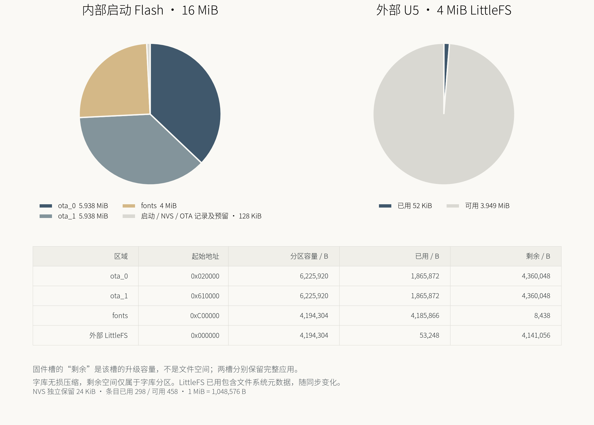

# Flash 分区与容量（0.6.0）

本页来自迁移后设备的 `storage_info` 实测快照，时间：`2026-10-17T12:31:41.314998+00:00`。
1 MiB = 1,048,576 bytes；1 KiB = 1,024 bytes。不是厂家十进制 MB。



## 两块独立 Flash

- XIAO 上的启动 Flash：16 MiB。用于引导、设置、A/B 应用及压缩中文字库。
- 驱动板 U5 ZB25VQ32：4 MiB，完整作为 LittleFS；日历和电价缓存已经迁移到这里。
- 8 MiB PSRAM 是易失性运行内存，用于画布、模型及字库解压缓存，不计入 Flash 容量。
- ESP32 固有 ROM 位于芯片内部，不占这两块 Flash；可更新的是 Flash 上的二级 bootloader 和应用。

## 内部 16 MiB

| 区域 | 起始地址 | 分区容量 / bytes | 实际镜像占用 / bytes | 分区内剩余 / bytes |
|---|---:|---:|---:|---:|
| ota_0 | `0x020000` | 6,225,920 | 1,865,872 | 4,360,048 |
| ota_1 | `0x610000` | 6,225,920 | 1,865,872 | 4,360,048 |
| fonts | `0xC00000` | 4,194,304 | 4,185,866 | 8,438 |

每个应用槽的上限为 **5.9375 MiB（6,225,920 bytes）**，比旧 4 MiB 槽增加
48.4375%。当前单个固件镜像约 1.7794 MiB，每槽约有
**4.1581 MiB** 可供后续代码增长。A、B 各自存放完整应用；
两个槽的剩余空间不能相加作为一个大固件的容量，也不能拿来存放普通文件。

内部字体分区是共享只读资源。思源黑体 Light 2.005 的四档原生 1-bit 字模
压缩后占 4,185,866 bytes，剩余 8,438 bytes。原始归档 7,555,344 bytes，
运行时按块无损解压；英文字体不变。字库已接近该分区容量，未来大幅扩字需要
单独规划资源布局，不能仅依靠应用槽的空闲空间。

起始 128 KiB 的细分如下；它们在饼图中合并为“启动 / NVS / OTA 记录及预留”：

| 内容 | 地址范围（末地址不含） | 大小 |
|---|---|---:|
| 二级 bootloader 预留 | `0x000000`–`0x008000` | 32 KiB |
| 分区表预留 | `0x008000`–`0x009000` | 4 KiB |
| NVS 设置与凭据 | `0x009000`–`0x00F000` | 24 KiB |
| 对齐预留 | `0x00F000`–`0x010000` | 4 KiB |
| 双扇区 OTA 记录 | `0x010000`–`0x012000` | 8 KiB |
| 对齐预留 | `0x012000`–`0x020000` | 56 KiB |

NVS 实测条目已用 **298**，可用 **458**。
条目数量不等于可保存的有效负载字节数；NVS 有页管理、垃圾回收和变长值开销。
Wi-Fi、Spotify 授权、日历订阅配置与配对密钥仍在内部 NVS，迁移没有写入该区域。

## 外部 4 MiB LittleFS

| 项目 | 实测值 |
|---|---:|
| 分区起始地址 | `0x000000` |
| 文件系统总容量 | 4,194,304 bytes（4 MiB） |
| 已用（含 LittleFS 元数据） | 53,248 bytes |
| 可用 | **4,141,056 bytes（3.9492 MiB）** |
| 挂载状态 | 已挂载 |
| JEDEC ID | `0x5E4016` |
| SPI 设置 | 10 MHz，CLK11 / MOSI13 / MISO12 / CS40 |

迁移前的内部文件系统为 3.875 MiB。完整复制并逐字节校验后，LittleFS 已扩容到
4 MiB，保留原有 4 个缓存文件。迁移前外部 Flash 全部原始内容有独立私有备份。
运行时不会因挂载失败而自动格式化。

文件系统占用会随着日历和电价同步变化；此处是快照，不是固定保留额度。
此容量也不会与固件槽合并，外部芯片不能直接作为标准启动应用槽。

## 升级与复现

当前布局标识：`inkos-ab594-extfs-v2`。例行 IP OTA 只写未运行的应用槽，校验后
自动重启，通过检查才确认。设置、外部文件系统、字库和分区表均不被例行 OTA 覆盖。
启动确认前重启的真实回滚已验证。详细流程见 [OTA](OTA.md)。

安装可选绘图依赖后，可重新生成设备实测报告；配对密钥以隐藏输入读取：

```powershell
python -m pip install -r tools/requirements-report.txt
python tools/storage_report.py --ip DEVICE_IP --output out/flash-layout.png
```

它同时保存不含凭据和文件内容的容量 JSON。也可使用
`--snapshot docs/validation/0.6.0-storage.json` 重绘本页快照。

验证记录：[存储快照](validation/0.6.0-storage.json)、[OTA 实机验证](validation/0.6.0-ota.json)。
